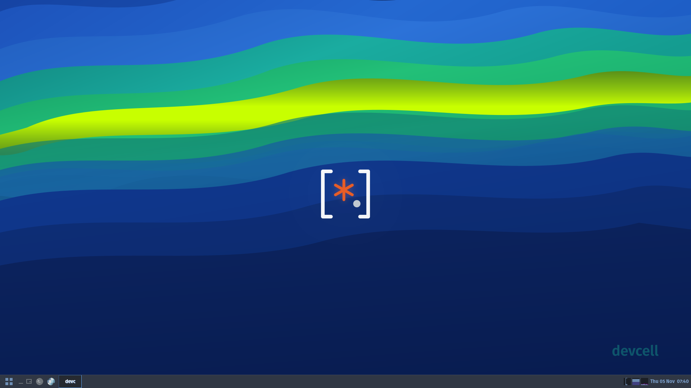
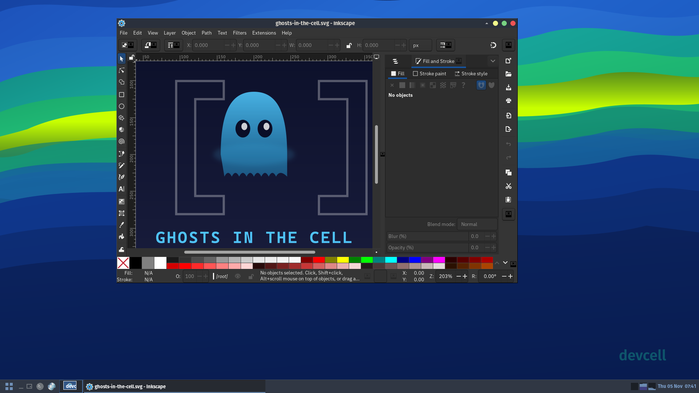
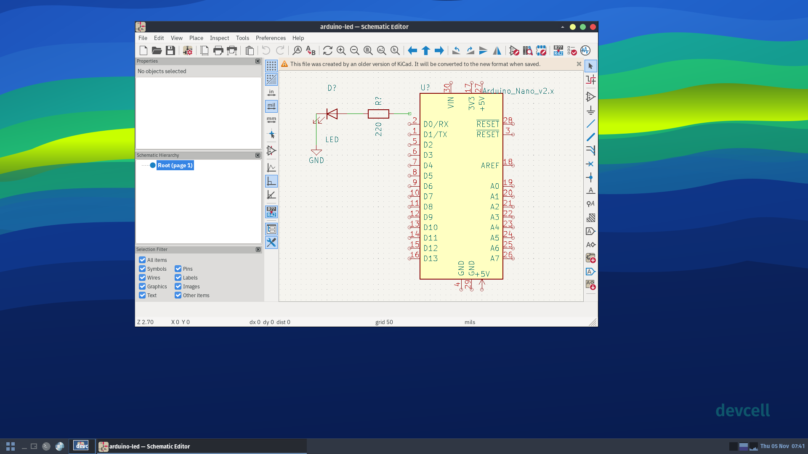
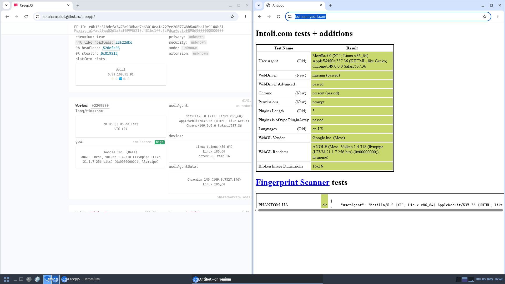
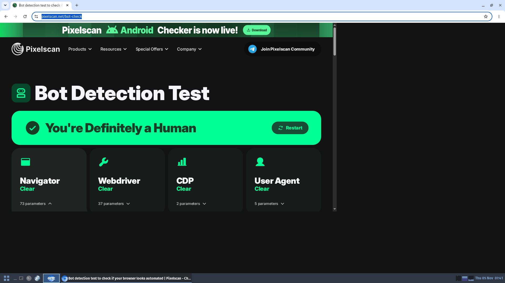

# community-home

Reproducible, AI-augmented developer environments as a Nix flake. Pick a stack, get every runtime, service, and AI coding tool you need: pinned, composable, running inside a container.

## Quick start

**With [devcell](https://github.com/devcell-sh/devcell):**

```toml
# .devcell.toml
[cell]
stack = "ultimate"
```

**As a standalone flake input:**

```nix
inputs.community-home.url = "github:devcell-sh/community-home";
```

Nothing here is devcell-specific except the entrypoint. Point home-manager at it directly and override anything.

## Stacks

| Stack | What you get |
|-------|-------------|
| **base** | Shell, git, core CLI tools |
| **dev** | base + stealth browser + infrastructure-as-code |
| **go** | base + Go toolchain + build tools + IaC |
| **node** | base + Node.js + stealth browser |
| **python** | base + Python + stealth browser |
| **fullstack** | base + Go + Node + Python + QA + browser + IaC |
| **electronics** | base + KiCad + desktop |
| **ultimate** | dev + Go + Node + Python + desktop GUI + graphics |
| **bbb** | ultimate + electronics, security, media, publishing, VPN |

Stacks are a starting point. This is Nix: everything is overridable.

### Customizing

Toggle modules on any stack via `.devcell.toml`:

```toml
[cell]
stack = "ultimate"
modules = ["electronics", "wine"]
```

Or compose directly in Nix. Import individual modules into your own home-manager configuration and set any option:

```nix
# in your home-manager modules list
imports = [
  "${community-home}/modules/base.nix"
  "${community-home}/modules/go.nix"
  "${community-home}/modules/desktop"
];

devcell.modules = {
  graphics.inkscape.enable = true;
  desktop.rdpClient.enable = true;
  go.enable = true;
};
```

The full module list lives in `modules/`. Each module is a standard Nix option interface: `enable`, configuration attributes, and package overrides. Write your own, drop it in `modules/`, and compose it into any stack.

## Why community-home

### Reproducible by default

Nix flake inputs pin every tool. Same stack = same environment on your laptop, your colleague's machine, and CI. No "works on my machine," no dependency drift. Full container isolation, not just a shell overlay.

### AI assistants with real tools

Claude Code, Codex, Gemini CLI, and OpenCode come pre-wired with MCP servers for web scraping, Terraform, PostgreSQL, browser automation, and more. Your coding agent runs inside the container with all its dependencies pre-resolved.

### Compose, don't configure

Stacks from minimal (`base`) to maximal (`bbb`). Toggle individual modules in `.devcell.toml` or compose in pure Nix. Import into your own flake and override any option. Platform teams set the base stack; developers toggle what they need.

### s6-rc service supervision

PostgreSQL, nix-daemon, dbus, Xvfb, window manager, x11vnc, and xrdp are proper supervised services with dependency ordering, health checks, and structured boot events. No systemd. No PID 1 hacks. Boot progress is observable end-to-end via `devcell-event`.

[Service dependency graph (34 services)](docs/s6-dependency-tree.md) | [Boot flow](docs/s6-flow.md)

<details>
<summary>Boot sequence (33 services, dependency-ordered)</summary>

```json
{"ts":"2026-11-04T12:00:01Z","scope":"service","service":"base-init","status":"up"}
{"ts":"2026-11-04T12:00:01Z","scope":"service","service":"env-setup","status":"up"}
{"ts":"2026-11-04T12:00:01Z","scope":"service","service":"secrets","status":"up"}
{"ts":"2026-11-04T12:00:01Z","scope":"service","service":"system-fixups","status":"up"}
{"ts":"2026-11-04T12:00:01Z","scope":"service","service":"shell-rc","status":"up"}
{"ts":"2026-11-04T12:00:01Z","scope":"service","service":"nix-daemon","status":"activating"}
{"ts":"2026-11-04T12:00:01Z","scope":"service","service":"pulseaudio","status":"activating"}
{"ts":"2026-11-04T12:00:02Z","scope":"service","service":"claude-config","status":"up"}
{"ts":"2026-11-04T12:00:02Z","scope":"service","service":"codex-config","status":"up"}
{"ts":"2026-11-04T12:00:02Z","scope":"service","service":"opencode-config","status":"up"}
{"ts":"2026-11-04T12:00:02Z","scope":"service","service":"gemini-config","status":"up"}
{"ts":"2026-11-04T12:00:02Z","scope":"service","service":"mcp-toggle","status":"up"}
{"ts":"2026-11-04T12:00:02Z","scope":"service","service":"gui-config","status":"up"}
{"ts":"2026-11-04T12:00:02Z","scope":"service","service":"mise","status":"up"}
{"ts":"2026-11-04T12:00:02Z","scope":"service","service":"homedir","status":"up"}
{"ts":"2026-11-04T12:00:02Z","scope":"service","service":"xvfb","status":"activating"}
{"ts":"2026-11-04T12:00:02Z","scope":"service","service":"nix-daemon","status":"up"}
{"ts":"2026-11-04T12:00:02Z","scope":"service","service":"pulseaudio","status":"up"}
{"ts":"2026-11-04T12:00:03Z","scope":"service","service":"xvfb","status":"up"}
{"ts":"2026-11-04T12:00:03Z","scope":"service","service":"window-manager","status":"activating"}
{"ts":"2026-11-04T12:00:03Z","scope":"service","service":"dbus-session","status":"activating"}
{"ts":"2026-11-04T12:00:03Z","scope":"service","service":"x11vnc","status":"activating"}
{"ts":"2026-11-04T12:00:03Z","scope":"service","service":"xrdp","status":"activating"}
{"ts":"2026-11-04T12:00:03Z","scope":"service","service":"window-manager","status":"up"}
{"ts":"2026-11-04T12:00:03Z","scope":"service","service":"dbus-session","status":"up"}
{"ts":"2026-11-04T12:00:03Z","scope":"service","service":"x11vnc","status":"up"}
{"ts":"2026-11-04T12:00:03Z","scope":"service","service":"xrdp","status":"up"}
{"ts":"2026-11-04T12:00:03Z","scope":"service","service":"xrdp-chansrv","status":"activating"}
{"ts":"2026-11-04T12:00:04Z","scope":"service","service":"snixembed","status":"up"}
{"ts":"2026-11-04T12:00:04Z","scope":"service","service":"xrdp-chansrv","status":"up"}
{"ts":"2026-11-04T12:00:04Z","scope":"service","service":"wallpaper","status":"up"}
{"ts":"2026-11-04T12:00:04Z","scope":"service","service":"project-flake","status":"up"}
{"ts":"2026-11-04T12:00:04Z","scope":"service","service":"gcroot","status":"up"}
```

</details>

### Full desktop in containers

Access GUI applications via VNC or RDP. The entire desktop stack: Xvfb, window manager, VNC, and RDP, is supervised by s6-rc and baked into the container image. Inkscape, KiCad, and other GUI tools run on a virtual display with no host-side X11 required.







### Passes bot protection out of the box

Patchright + Chromium with anti-detection patches for AI-driven browser automation. Passes [bot.sannysoft.com](https://bot.sannysoft.com), [CreepJS](https://abrahamjuliot.github.io/creepjs/), and other fingerprinting tests without additional configuration.





## Layout

```
modules/   Toggleable capabilities (go, node, infra, scraping, desktop, llm, ...)
stacks/    Named combinations of modules (base, dev, ultimate, bbb, ...)
hosts/     Host-specific bits (macOS, Linux)
packages/  Things nixpkgs doesn't have or has wrong
```

## Contributing

Fork, add a module in `modules/`, register it in your stack, run `task test`. CI validates with statix, deadnix, nixfmt, shellcheck, and `nix flake check` across all platforms.

## License

[Apache-2.0](LICENSE)
